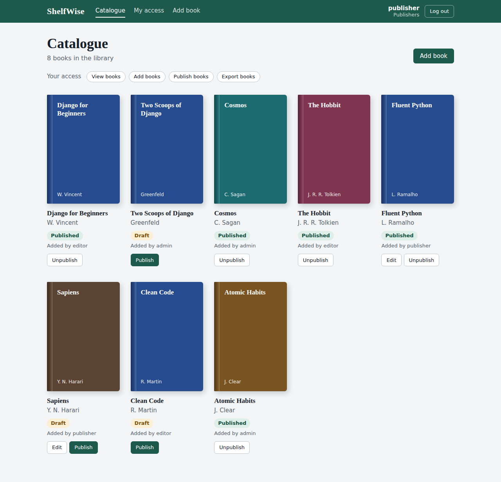
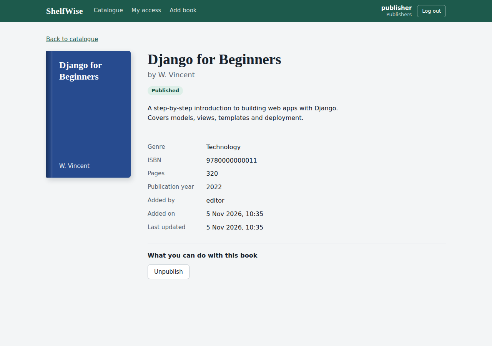

# ShelfWise

[](https://github.com/roshaniballal/shelfwise/actions/workflows/tests.yml)


**A role-based library management system built with Django.**
Admins, editors, publishers and readers each see, and can do, different things. Access is enforced with Django's own permission system: groups, custom permissions, ownership rules and draft visibility.

| Catalogue | Book detail |
|---|---|
|  |  |

## Features

- **Book catalogue** shown as a shelf of covers, colored by genre, with published and draft status
- **Role-based access:** the same page shows different actions depending on who is logged in
- **Add, edit, publish, unpublish and delete books,** each guarded by its own permission
- **Draft visibility:** drafts are visible only to their owner, editors and publishers
- **Ownership rules:** owners can edit their own books, and users with the edit permission can edit any book
- **My access page** that shows which permissions you have and whether each came from a group or was assigned directly
- **Django admin** with permission-aware restrictions
- **35 automated tests** covering the permission rules

## Who can do what

Measured against the demo accounts (see below).

| Action | admin | editor | publisher | viewer | direct_perm | anon_like |
|---|:-:|:-:|:-:|:-:|:-:|:-:|
| Open a published book | ✔ | ✔ | ✔ | ✔ | ✔ | ✘ |
| Open someone else's draft | ✔ | ✔ | ✔ | ✘ | ✘ | ✘ |
| Add a book | ✔ | ✔ | ✔ | ✘ | ✘ | ✘ |
| Edit any book | ✔ | ✔ | own only | ✘ | ✘ | ✘ |
| Publish or unpublish | ✔ | ✘ | ✔ | ✘ | ✘ | ✘ |
| Delete a book | ✔ | ✘ | ✘ | ✘ | ✔ | ✘ |
| Export CSV (`/export/`) | ✔ | ✘ | ✔ | ✘ | ✘ | ✘ |

## Quick start

You need **Python 3.12 or newer** (Python 3.10+ works if pip installs Django 5.2).

```bash
git clone https://github.com/roshaniballal/shelfwise.git
cd shelfwise

# 1. create and activate a virtual environment
python -m venv venv
venv\Scripts\activate          # Windows (cmd or PowerShell)
source venv/bin/activate       # macOS / Linux

# 2. install dependencies
pip install -r requirements.txt

# 3. create the database and the demo data
python manage.py migrate
python manage.py seed_demo

# 4. run the app
python manage.py runserver
```

Open <http://127.0.0.1:8000/> and log in at `/login/`.

> On Windows, if PowerShell refuses to activate the environment, use `cmd` instead, or run
> `Set-ExecutionPolicy -Scope Process RemoteSigned` once in that window.

## Demo accounts

Every account uses the password **`test1234`**. The login page lists them too.

| Username | Role |
|---|---|
| `admin` | Superuser, can do everything |
| `editor` | Staff. Can view, add and edit any book, and can enter `/admin/` |
| `publisher` | Can view, add, publish and export books. Can edit only their own books |
| `viewer` | Can view published books only |
| `direct_perm` | View and delete, assigned directly to the user (no group) |
| `anon_like` | Logged in, but has no permissions |
| `inactive` | Disabled account, cannot log in |

Use `/admin/login/` only for the Django admin. It accepts staff users (`admin`, `editor`). Everyone else logs in at `/login/`.

## How the permissions are built

| Concept | Where to look |
|---|---|
| Default model permissions (`add`, `change`, `delete`, `view`) | `library/models.py` |
| Custom permissions (`publish_book`, `export_book`) | `Meta.permissions` in `library/models.py` |
| Groups, user-level permissions, superuser, `is_staff`, `is_active` | `library/management/commands/seed_demo.py` |
| `@login_required`, `@permission_required`, `@user_passes_test` | `library/views.py` |
| `PermissionRequiredMixin`, `UserPassesTestMixin` (class-based views) | `library/views.py` |
| Object-level rules written by hand (owner can edit, drafts are hidden) | `edit_book`, `book_detail` in `library/views.py` |
| Template checks with `` | `library/templates/library/` |
| Admin permission hooks (`has_change_permission`, `get_queryset`) | `library/admin.py` |
| A test for every behaviour above | `library/tests.py` |

## Running the tests

```bash
python manage.py test
```

The suite has 35 tests. Each one demonstrates a single permission rule, so reading `library/tests.py` is a quick way to learn the behaviour.

## Configuration

Settings are read from environment variables. Everything has a safe local default, so none are needed to run locally. To customise, copy `.env.example` to `.env`:

| Variable | Purpose | Default |
|---|---|---|
| `DJANGO_SECRET_KEY` | Django secret key | an insecure development key |
| `DJANGO_DEBUG` | `True` or `False` | `True` |
| `DJANGO_ALLOWED_HOSTS` | Comma-separated host names | empty |

## Project structure

```
shelfwise/
├── config/                 Django project settings and root URLs
├── library/                The app
│   ├── models.py           Book model, default and custom permissions
│   ├── views.py            Every permission pattern, with comments
│   ├── forms.py            Add and edit forms
│   ├── admin.py            Admin-level permission hooks
│   ├── tests.py            Permission tests
│   ├── static/library/     Stylesheet and favicon
│   ├── templates/          Pages, shared layout and error pages
│   └── management/commands/seed_demo.py   Demo users, groups and books
├── docs/screenshots/
├── requirements.txt
└── manage.py
```

## Roadmap

- Reviews, where only the author or a moderator can delete a review
- A REST API with Django REST Framework (`DjangoModelPermissions` and a custom permission class)
- Per-object permissions with `django-guardian`
- Search, genre filters and pagination, with drafts hidden at the queryset level
- An audit log of who published, edited or deleted what

## Not for production

This is a demonstration project. It uses SQLite, shows the demo passwords on the login page, and has no deployment configuration. Remove the demo accounts panel and set real environment variables before you put anything like it online.

## License

MIT. See [LICENSE](LICENSE).
